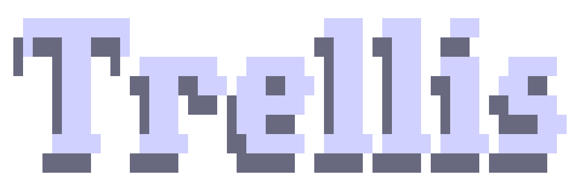

<p align="center">
<picture>
<source srcset="assets/phronia.png" media="(prefers-color-scheme: dark)">
<source srcset="assets/phronia.png" media="(prefers-color-scheme: light)">

</picture>
</p>

<p align="center">
<strong>An out-of-the-box engineering framework for AI coding.</strong><br/>
<sub>AI writes code fast, but every session it starts from scratch — no memory of your project, your conventions, or your team's requirements. Phronia persists specs, tasks, and memory into your repo, so any coding agent works to your engineering standards.</sub>
</p>

<p align="center">
<a href="./README_CN.md">简体中文</a> •
<a href="https://docs.trytrellis.app/">Docs</a> •
<a href="https://docs.trytrellis.app/start/install-and-first-task">Quick Start</a> •
<a href="https://docs.trytrellis.app/advanced/multi-platform">Supported Platforms</a> •
<a href="https://docs.trytrellis.app/start/real-world-scenarios">Use Cases</a>
</p>

<p align="center">
<a href="https://www.npmjs.com/package/@phronia/cli"></a>
<a href="https://www.npmjs.com/package/@phronia/cli"></a>
<a href="https://github.com/mindfold-ai/Trellis/blob/main/LICENSE"></a>
<a href="https://github.com/mindfold-ai/Trellis/stargazers"></a>
<a href="https://docs.trytrellis.app/"></a>
<a href="https://discord.com/invite/tWcCZ3aRHc"></a>
<a href="https://github.com/mindfold-ai/Trellis/issues"></a>
<a href="https://github.com/mindfold-ai/Trellis/pulls"></a>
<a href="https://deepwiki.com/mindfold-ai/Trellis"></a>
<a href="https://chatgpt.com/?q=Explain+the+project+mindfold-ai/Trellis+on+GitHub"></a>
</p>

<p align="center">

</p>

## Why Phronia?

| Capability | What it changes |
| --- | --- |
| **Auto-injected specs** | Write conventions once in `.phronia/spec/`, then let Phronia inject the relevant context into each session instead of repeating yourself. |
| **Task-centered workflow** | Keep PRDs, implementation context, review context, and task status in `.phronia/tasks/` so AI work stays structured. |
| **Project memory** | Journals in `.phronia/workspace/` preserve what happened last time, so each new session starts with real context. |
| **Team-shared standards** | Specs live in the repo, so one person's hard-won workflow or rule can benefit the whole team. |
| **Multi-platform setup** | Bring the same Phronia structure to 22 AI coding platforms instead of rebuilding your workflow per tool. |

## Prerequisites:

- **Node.js** >= 18
- **Python** >= 3.9

## Quick Start

```bash
# 1. Install Phronia. This does not replace an existing
#    @mindfoldhq/trellis install: the package publishes only the
#    `phronia` bin, so both CLIs can coexist.
npm install -g @phronia/cli@latest

# 2. New project: initialize in your repo
phronia init -u your-name

# 3. Or initialize with the platforms you actually use
phronia init --cursor --opencode --codex -u your-name
```

Existing `.trellis/` project? Migrate without uninstalling the old CLI:

```bash
phronia adopt --dry-run
phronia adopt
```

See the [Quick Start](https://docs.trytrellis.app/start/install-and-first-task) and [Supported Platforms](https://docs.trytrellis.app/advanced/multi-platform) guides for setup details.

## How to Use

The workflow is simple:

1. **Describe what you want** in natural language.
2. **Brainstorm** with the AI one question at a time until the PRD is clear, then implementation begins.
3. **Let it run** — the AI calls Phronia Implement and auto-checks the result against specs, lint, type-check, and tests.
4. **Type `/phronia:finish-work`** when the work is done or the session context fills up. Phronia archives the task and updates journals.

## How It Works

Phronia runs a 4-phase loop with auto-invoked skills and sub-agents:

1. **Plan** — `phronia-brainstorm` walks through requirements one question at a time and writes `prd.md`. Research-heavy items go to a `phronia-research` sub-agent. The result is curated specs + research files referenced from `implement.jsonl` / `check.jsonl`.
2. **Implement** — a `phronia-implement` sub-agent writes code from the PRD with the curated context auto-injected, no git commit.
3. **Verify** — a `phronia-check` sub-agent reviews the diff against specs and runs lint, type-check, and tests, self-fixing where it can.
4. **Finish** — a final check runs, then `phronia-update-spec` promotes new learnings back into `.phronia/spec/` so the next session starts smarter.

## Parallel Tasks and Coordinator Mode

Phronia can run several independent tasks side by side and land them serially. The workflow is optional and builds on the same tasks, PRDs, worktrees, and archive flow.

```bash
# Declare each task's surface in task.json: meta.parallel.touches / depends_on
phronia task parallel plan --explain     # which tasks can share a wave, and why
phronia task workspace ensure <ref>      # reuse-current | attach | create | refuse
phronia task commit <ref>                # commit inside the task worktree
phronia task integrate <ref>             # local rebase/verify/ff, or push + PR/MR
phronia task integrate --drain           # land a batch in FIFO order
```

Caveats:

- **One task, one branch, at most one worktree.** Sessions attach to a task's workspace; they do not create a second one. Phronia cannot move a running session, so when `workspace ensure` returns `create`, start a new session in the printed directory.
- **Unknown footprint = serial.** A task without `touches` / `relatedFiles` is scheduled alone rather than guessed into a batch.
- **Integrate is not archive.** Integrate records `meta.integration.outcome` (`landed` / `pushed` / …); `finish-work` archives afterwards. Archiving refuses a dirty worktree or a clean-but-unlanded one, and removes a landed worktree automatically.
- **Locks are repository-local.** The integration lock and workspace claim are shared by the worktrees of one repository (one object database); they are not cross-machine locks. Team projects should use remote mode and the forge's merge queue. Phronia never merges remotely.
- **Coordinator mode is gated.** `phronia task parallel dispatch --batch <id>` only emits a manifest; your harness spawns the sub-agents. It requires parallel sub-agents with per-task workspaces — Claude Code is the only verified candidate today. Codex and ZCode fall back to multi-session (one window/worktree per task) or serial; unverified platforms are unsupported. Run `phronia task parallel status --json` to see the gate.

## Resources

| Need                            | Link                                                                           |
| ------------------------------- | ------------------------------------------------------------------------------ |
| Install Phronia in a repo       | [Quick Start](https://docs.trytrellis.app/start/install-and-first-task)        |
| Understand platform differences | [Supported Platforms](https://docs.trytrellis.app/advanced/multi-platform)     |
| See the workflow in practice    | [Real-World Scenarios](https://docs.trytrellis.app/start/real-world-scenarios) |
| Start from spec templates       | [Spec Templates](https://docs.trytrellis.app/templates/specs-index)            |
| Track releases                  | [Changelog](https://docs.trytrellis.app/changelog)                             |

## FAQ

<details>
<summary><strong>How is Phronia different from <code>CLAUDE.md</code>, <code>AGENTS.md</code>, or <code>.cursorrules</code>?</strong></summary>

Those files are useful entry points, but they tend to become monolithic. Phronia adds scoped specs, task PRDs, workflow gates, workspace memory, and platform-aware generated files around them.

</details>

<details>
<summary><strong>Is Phronia only for Claude Code?</strong></summary>

No. Phronia is a project layer that works across multiple coding agents and IDEs.

</details>

<details>
<summary><strong>Is Phronia for solo developers or teams?</strong></summary>

Both. Solo developers use it for memory and repeatable workflow. Teams get the larger benefit: shared standards, task boundaries, reviewable context, and platform portability.

</details>

<details>
<summary><strong>Do I have to write every spec file manually?</strong></summary>

No. Many teams start by letting AI draft specs from existing code and then tighten the important parts by hand. Phronia works best when you keep the high-signal rules explicit and versioned.

</details>

<details>
<summary><strong>Can teams use this without constant conflicts?</strong></summary>

Yes. Personal workspace journals stay separate per developer, while shared specs and tasks stay in the repo where they can be reviewed and improved like any other project artifact.

</details>

<details>
<summary><strong>Can I temporarily compare a project with and without Phronia?</strong></summary>

Yes. `phronia ablate` temporarily removes all supported project-owned Phronia
surfaces after creating a verified recovery transaction outside the project.
Start a fresh agent session for the comparison, then run `phronia restore` to
recover the exact prior state. Use `--dry-run` to preview either operation.
The private recovery transaction includes exact `.phronia` task, spec, and
workspace bytes, which may contain user-authored sensitive text, and is kept
until restore verifies successfully.

This is different from `phronia uninstall` (permanent removal) and
`PHRONIA_HOOKS=0` (hooks only). Ablation does not launch agents, manage
worktrees, hide Git changes, or remove the global CLI, channel logs, or host
transcripts. If a managed path changes while ablated, restore refuses all
writes until the conflict is resolved.

</details>

## Star History

[](https://star-history.dera.page/#mindfold-ai/Trellis&Date)

## Community & Resources

- [Official Docs](https://docs.trytrellis.app/)
- [GitHub Issues](https://github.com/mindfold-ai/Trellis/issues)
- [Discord](https://discord.com/invite/tWcCZ3aRHc)
- [Tech Blog](https://docs.trytrellis.app/blog)

<p align="center">
<a href="https://github.com/mindfold-ai/Trellis">Official Repository</a> •
<a href="https://github.com/mindfold-ai/Trellis/blob/main/LICENSE">AGPL-3.0 License</a> •
Built by <a href="https://github.com/mindfold-ai">Mindfold</a>
</p>
